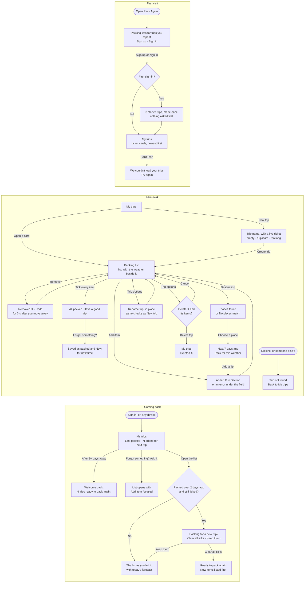

# Pack Again

Pack Again is a packing list for trips you take again and again: a weekend at your parents', a conference, a beach weekend. If you rebuild the same list from memory each time and forget the same things, Pack Again keeps the list for you. Open it, tick items off as you pack, add anything you forgot for next time, and find the list ready when the next trip comes around. Add where you're going to see the next 7 days' weather beside the list, with what to pack for it. Sign up and three starter trips are waiting; your trips are there on any device you sign in on.

Live: https://design-assignment4.vercel.app

## Flows

First visit, main task, coming back. Notes: [flows.md](flows.md).



## Run it locally

You need Node.js 20.9 or newer, a Clerk application and a Supabase project, both on free plans.

1. **Database:** apply the migrations in [`supabase/migrations/`](supabase/migrations/) to the Supabase project, in filename order (see [Database](#database)).
2. **Sign-in:** in Clerk, Integrations › Supabase › Activate, and copy the domain it shows. In Supabase, Authentication › Sign In / Providers › Third-party auth › Clerk, and paste it.
3. **Keys:** create `.env.local` with these variables, and never commit it:
   - `NEXT_PUBLIC_CLERK_PUBLISHABLE_KEY` and `CLERK_SECRET_KEY`: Clerk's development keys.
   - `NEXT_PUBLIC_SUPABASE_URL`: the project's URL, origin only (`https://<project-ref>.supabase.co`).
   - `NEXT_PUBLIC_SUPABASE_PUBLISHABLE_KEY`: the publishable key, never the secret key.
   - For the end-to-end test only, `E2E_USER_A_EMAIL` and `E2E_USER_B_EMAIL`: the emails of two test users in Clerk's development instance.
4. **Start it:**

   ```bash
   npm install
   npm run dev
   ```

   Then open http://localhost:3000.

Two checks:

- `npm run check:contrast` checks the contrast of every color pair the app uses.
- `npm run test:e2e` signs in the two test users and checks that neither sees the other's trips. It starts its own dev server on port 3100, or the port in `E2E_PORT`. Next.js allows one dev server per project, so if yours is running, point the test at it instead: `E2E_BASE_URL=http://localhost:3000 npm run test:e2e`.

## What it remembers

Your trips are saved in Supabase under your account: their items and sections, which items are ticked or marked New, the destination (its name, country, coordinates and time zone), when each trip was last packed, when you cleared the ticks, and whether you answered "Packing for a new trip?". Your profile records only when the starter trips were added, so each account gets them once.

Every row carries your Clerk user id, and row-level security lets only you read or change it. A signed-out visitor sees no one's data. The browser reaches Supabase with your Clerk session token and the publishable key; the app never uses Supabase's secret key.

The forecast is never saved. Your browser asks Open-Meteo for it and keeps it in the tab for 30 minutes, so Open-Meteo sees your IP address along with the destination. Trips saved in a browser before accounts existed are ignored. There are no analytics, and the fonts are served by the app itself.

## Database

The tables, row-level security policies and functions are the migrations in [`supabase/migrations/`](supabase/migrations/). They're applied in filename order, and each name starts with its version.

Two of them are a pair from step 7:

1. `20261023074853_step7_break_trips_select.sql` breaks row-level security on purpose, so the end-to-end test could be seen failing.
2. `20261023212046_step7_restore_trips_select.sql` sorts after it and puts row-level security back.

The restore uses `drop policy if exists`, so it never fails. On a fresh project both run and cancel out. On the current project the restore was run by hand in the SQL Editor, so it isn't in the migration history and does nothing when it's applied there.

To check that a project ended up secure, run this in Supabase › SQL Editor:

```sql
select tablename, count(*) as policies from pg_policies where schemaname = 'public' group by tablename;
```

It should list 4 policies on `trips`, 4 on `items` and 2 on `profiles`. None should be named "Step 7: …".

## Second polish pass

On the `polish` branch, in batches, with [before and after screenshots](docs/polish-2/) of every screen at 390px and 1440px.

- **The trip page in two zones.**
  - **The list:** the runway and count, with Clear all ticks beside them once something is ticked; the Add item form, on one row on wider screens; then the sections.
  - **The weather:** everything about the destination, in one place. On wider screens it's a panel beside the list that stays in view as you scroll. On a phone it's one block at the top that opens and closes, showing today's high, low and first tip while closed.
  - **Trip options:** Rename trip and Delete trip, in a menu beside the trip's name.
- **Destination codes.** A trip that's going somewhere takes its city's first 3 letters, like an airport: MAD for Madrid, MAL for Málaga, SAO for São Paulo. Trips without a destination keep the code their name gives them.
- **Fixed: pages kept in the background.** Next.js 16 keeps visited pages alive and shows them again as they were left. That broke a few things, in production too:
  - A card you'd opened kept its plane at the end of the runway and wouldn't open again.
  - My trips didn't say "Deleted …".
  - New trip came back with the last trip's name.
  - A trip opened again showed its last message, and focus didn't go to its name.

  Every visit now starts fresh, as it always did.
- **A more delightful My trips.**
  - **A greeting:** "Good evening, Alejandro." and one line on where the trips stand ("2 trips to pack, 1 packed."), by the person's own clock and their account's first name.
  - **Where each trip goes, and its weather today there:** "MÁLAGA, SPAIN", and under the name an icon with the words and the high and low. It's the same forecast the trip page shows, so opening the trip asks Open-Meteo for nothing more. Trips with no destination invite "Add a destination for weather tips", which opens the trip ready to type one.
  - **A status stamp** on each stub: NOT STARTED, BOARDING 40% or PACKED.
  - **Motion:** the tickets come in one after another the first time they show, a card lifts 2px on hover or keyboard focus, a stamp presses on when its status changes, and a code flips like a departures board when the destination changes it. All of it 200ms or less per element, and none of it with reduced motion.

## History: assignment 3

Before accounts, Pack Again kept everything in the browser. These sections are from then.

### First-run check

An AI agent used the live app twice as a first-time user, judging only from the screen: first visit, adding items (including an empty submit and a duplicate), ticking, removing, finishing a list, adding something forgotten, coming back in a new tab, at 1440px and 390px, and once with the keyboard only. It had built the app itself, so it wasn't a truly fresh user; treat this as a first pass before testing with people.

**Summary.** Useful within about 5 seconds and two clicks, with no sign-up and realistic starter trips. You always know where you are, errors appear under the field and keep what you typed, ticks don’t rely on color, your trips are remembered, and the keyboard flow works. The first round's weak spots were feedback you can't see and changes you can't take back; the second round found smaller issues with keyboard reach, visual cues and wording.

**Round 1: the 5 problems, most severe first**

1. **Removing was instant and permanent.** After a removal, the next row's Remove slid under the pointer, so a second click deleted another item.
2. **The "forgot last time" memory was fragile.** Unticking and re-ticking any item in a fully packed list erased every New mark, so the count on My trips never showed.
3. **"All packed" appeared off screen.** It showed at the top of the page while you ticked the last item at the bottom.
4. **No visible confirmation when adding.** An item added to a section further down appeared off screen; the "Added" message was only for screen readers.
5. **Errors didn't say what to do and lingered.** "Sunscreen is already in Toiletries" gave no next step, and old errors stayed on screen after moving on.

**Round 2: the 5 problems, most severe first**

1. **Undo was hard to reach with the keyboard.** It lived only in the bar at the top, several Shift+Tab presses away.
2. **After opening a list with the keyboard, the first Tab landed on nothing visible.**
3. **"Forgot something?" was far from where you finish.** The form is at the top; you tick the last item at the bottom.
4. **The success icon looked like a checkbox.** A filled square with a tick, like a ticked item.
5. **Old messages stayed in the bar.** "Added…" stayed up while a new error appeared under the field.

**What I changed**

| Problem | Decision | What changed |
|---|---|---|
| Permanent removal | Fixed | A "Removed Socks · Undo" row in the item's place, with Undo focused, and the same Undo in the bar. Both go 3 seconds after you move away from them (hovering or keyboard focus keeps them), or at your next change. Undo puts the item back and focuses it. |
| New marks erased | Fixed | New marks clear only when the next trip is packed (after Clear all ticks), not when you re-tick within the same trip. |
| Success off screen | Fixed | The count, plane and "All packed" sit in a bar that sticks to the top as you scroll. |
| No add confirmation | Fixed | The bar shows "Added Sunglasses to Other" on screen, not only to screen readers. |
| Errors | Fixed | "…is already in Toiletries. Tick it there or use another name". Errors clear when the form changes or you leave an empty field. |
| Lost Tab stop on arrival | Fixed | Opening a list moves focus to its name, so the next Tab reaches Back to My trips. |
| Old bar messages | Fixed | A new form error clears the previous message from the bar. |
| Success icon like a checkbox | Fixed | "All packed" now shows the plane icon. |
| "Forgot something?" far away | Fixed | A "Forgot something? Add it" link next to "All packed" takes you to the Add item field. |
| Confusing copy and naming | Fixed | One name for creating a trip: "New trip", "Trip name", "Create trip". Cards say "N added for next trip"; both buttons say "Clear all ticks". |
| Codes like WEP looked meaningful | Fixed | The 3-letter codes are smaller and decorative; the list name is the main text. |
| Bar line wider than the cards | Fixed | The bar's divider now matches the card width. |
| Empty space beside New trip | Fixed | New trip lines up with the cards when there's no intro line. |
| On phones the form sits above the list | Left for later | The list is reachable by scrolling and the bar shows progress; collapsing the form is a bigger layout change. |
| Item names can't be edited | Left for later | Remove and add again works, and Undo makes removing safe; editing would add a form state to every row. |

**Final polish (after the two rounds)**

An audit against AGENTS.md and the assignment, then the features left out of the plan:

- **Undo goes after 3 seconds, but only once you move away.** Hovering it or keeping keyboard focus on it pauses the countdown, so it isn't taken away from someone slower; if it goes while focused, focus moves to the next item.
- **Rename trip**, in place, with the same checks and messages as New trip. Escape cancels; focus returns to the button.
- **Delete trip**, with a confirmation in place ("Delete Beach weekend and its 15 items? This can't be undone."), not a modal. Focus goes to the question, so an extra Enter can't delete; afterwards My trips says "Deleted …" and focus lands there.
- **Tabs stay in sync.** Every change is applied to what's saved at that moment, so two open tabs, or two quick changes, never overwrite each other.
- **One word for one thing:** a trip is a trip everywhere ("No trips yet", "Trip not found", "Loading your trips…"); both duplicate errors end "use another name".
- **Shared components everywhere:** text links, text buttons and section headings now come from shared components, like buttons, fields and cards.
- **Clearer hierarchy:** Rename and Delete are quiet text actions under Clear all ticks; the "Add an item" heading, which only repeated the button, is now for screen readers only; the boarding pass stub has its own tint.
- **Motion where it helps:** opening a trip runs its plane down the runway (0.2 s) and morphs the card's name into the page title; ticking an item draws its check and strike-through, and ticking the last one takes off before All packed appears; added rows grow in, NEW badges stamp in. Everything takes 150 to 300 ms, never blocks a click, and none of it runs with reduced motion; new-tab clicks open straight away.
- **No dead ends:** unexpected errors get a designed page with Try again; the newer-version notice has a Reload button; the home link says it's the current page on My trips.

**Choices I made along the way**

- An empty list still focuses the Add item field when it opens, instead of the list name, because typing the first item is the only thing to do there.
- "Forgot something? Add it" is a button styled as a link, because it moves focus within the page rather than going to another page.
- Deleting a trip asks first instead of offering Undo: it removes a whole list, and the question is in place, not a modal.
- Save in Rename uses the secondary button and the Delete trip confirmation a solid ink one, so Add item stays the only accent on a list page.

### Polish pass

Before the database step, an audit of every screen and state at 390px and 1440px ([audit and plan](docs/polish/audit.md), [before](docs/polish/before/) and [after](docs/polish/after/) screenshots) led to three batches:

- **Visual polish:** the packing bar keeps one height, so the list never jumps when a message or All packed appears; runways line up from card to card; Remove is quieter than the item names; loading states have the shape of what loads; empty states are dashed tickets; one style for text actions; a warning sign and a solid ink button on Delete trip; the trip's code on its page; the Departures plane as the favicon.
- **Motion:** the takeoffs, the title morph, rows easing in, the NEW stamp and panels fading in place, as above.
- **A live ticket on New trip,** showing the name and code as you type.

Ideas that need new saved fields wait in [docs/plan.md](docs/plan.md). The saved data and its key didn't change.
