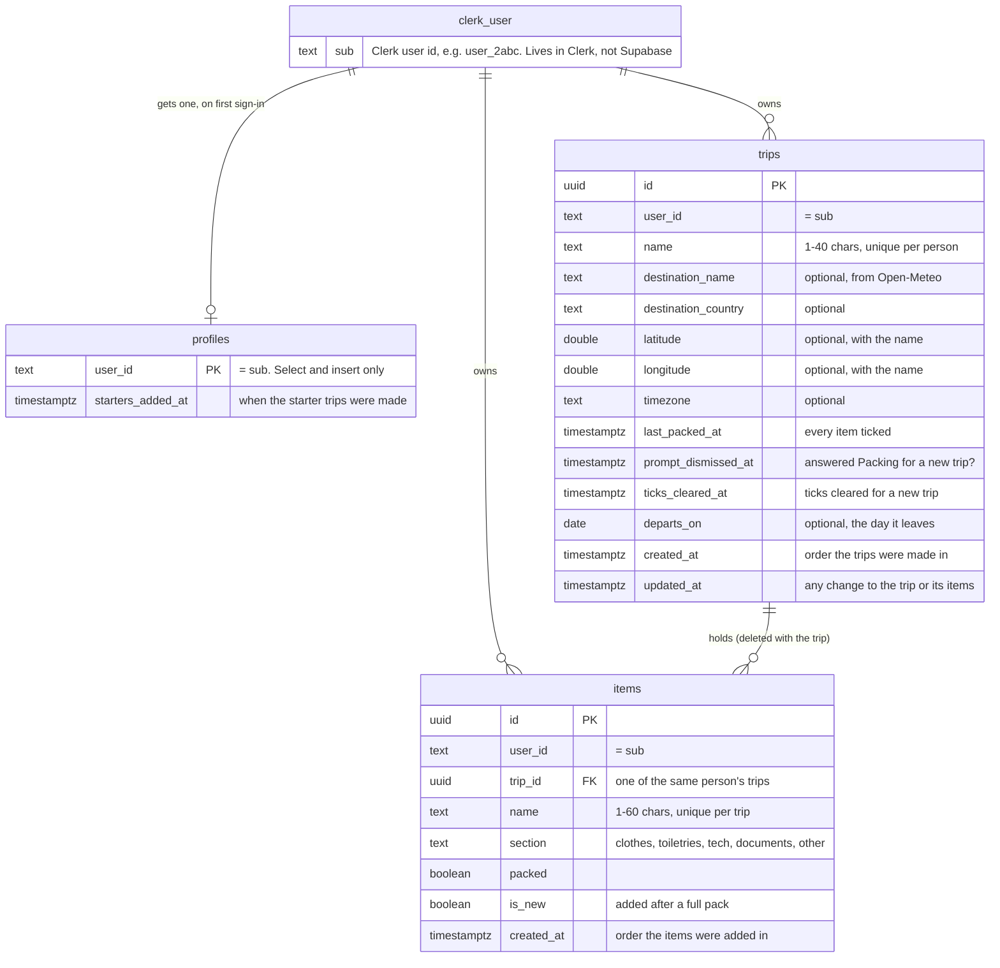

# Data model

Three tables in Supabase. The SQL is in [`supabase/migrations/`](../supabase/migrations/).

## How each row belongs to one person

1. The browser sends Supabase the person's Clerk session token with every request.
2. Supabase checks the token against Clerk, and `auth.jwt()->>'sub'` is that person's Clerk user id.
3. **Writing:** a new row's `user_id` defaults to that id, so the app never sends it.
4. **Reading and changing:** every table has row-level security. Its select, insert, update and delete policies only match rows where `user_id` is that id. An item can also only point at a trip with the same `user_id`.
5. **Signed out:** with no token, the request runs as `anon`, which has no access to any table.

The forecast is never saved: only where a trip is going, and optionally the day it leaves (`departs_on`, a calendar day from 2000 to 2099). The starter trips are made once per person, by `add_starter_trips()`. Because a profile can't be changed or deleted, deleting every trip doesn't bring them back.
