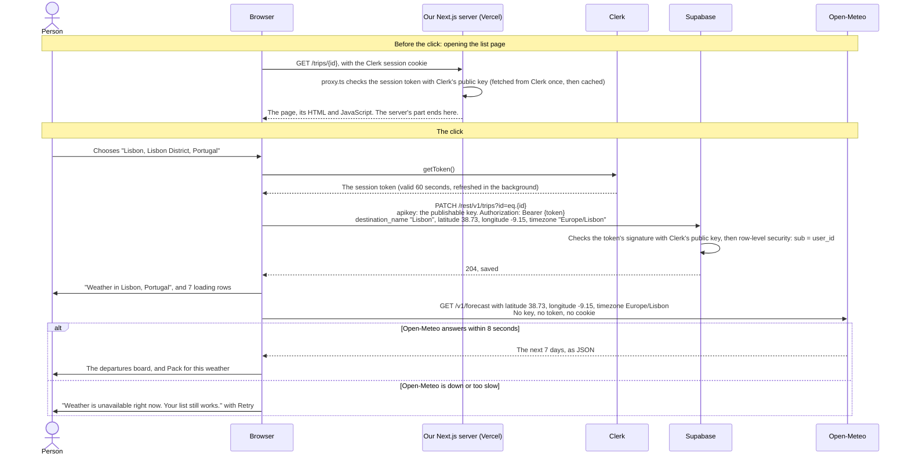
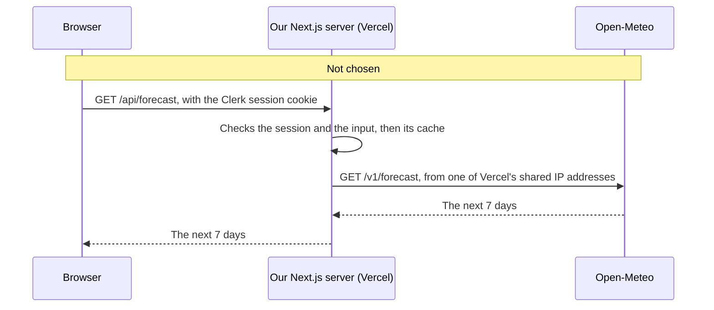

# One request, from the click to the screen

On a list page, the person searches "Lisbon" under Weather and chooses "Lisbon, Lisbon District, Portugal". The destination is saved in Supabase, then the forecast comes from Open-Meteo, straight to the browser. Our Next.js server only served the page, earlier, and plays no part in the click.

## What each call carries

- **To our server:** the Clerk session cookie, when a page opens. Clerk's secret key stays on the server, where `proxy.ts` uses it.
- **To Supabase:** the publishable key, which is meant to be public, and the session token, which says who is asking. Supabase's secret key isn't used anywhere in the app.
- **To Open-Meteo:** only the coordinates and the time zone. Open-Meteo needs no key, and the browser sends it no token and no cookie.

Loading the trips when a page opens works the same way as the save: a token from Clerk, then Supabase.

## Why the weather call skips our server

Decided in step 6; the same reasons are in [AGENTS.md › Weather](../AGENTS.md).

- **No key to hide.** Hiding a key is the main reason to send a call through a server.
- **Rate limits.** Open-Meteo allows 10,000 calls a day per IP address. From the browser, each person uses their own. From our server, every user would share Vercel's IP addresses, and so would other apps on Vercel.
- **Caching.** On Vercel's serverless functions an in-memory cache rarely lasts between requests, and a shared cache costs extra. The browser keeps a forecast for 30 minutes and a place search for a day.
- **Cost.** No function calls or CPU time on the Hobby plan.
- **The trade-off.** Open-Meteo sees each person's IP address with the destination, and keeps its logs for 90 days.

If the call had gone through our server, the forecast would have taken one more hop:

