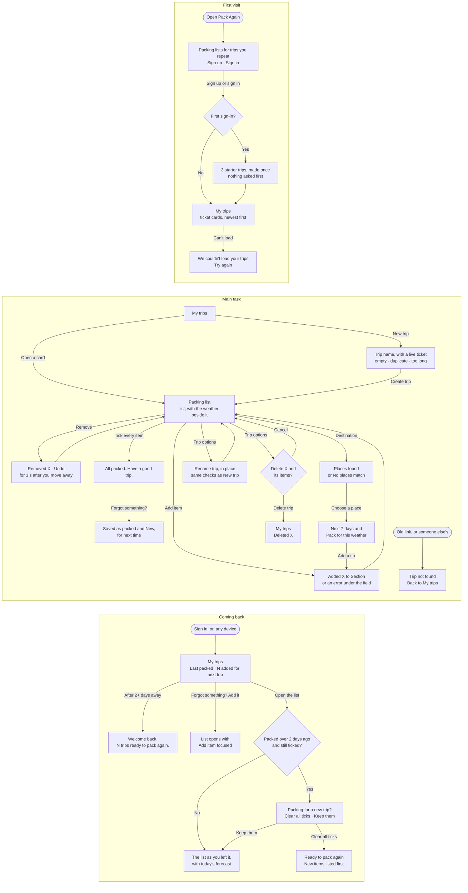

# Flows

First visit → main task → coming back. Routes: `/` the landing page signed out and My trips signed in, `/sign-in` and `/sign-up`, `/trips/new` New trip, `/trips/[id]` Packing list.

## Notes

- Signed out, `/` is the landing page and every page but sign-in and sign-up goes to sign-in, then back.
- Starter trips are made once per account, on its first sign-in, together with the profile that records it. Deleting every trip later shows "No trips yet" with "Add the starter trips back", not the starters again.
- Trips load once when a tab opens, and changes save one after another. Ticks, removals and clearing show straight away and save in the background; one that doesn't save comes off the screen again, and the bar says "Not saved". New trips, names, items and destinations save first, so a form keeps what you typed if saving fails. Another tab or device shows a change the next time it loads.
- An item added from "Forgot something?" is saved as already packed, so the list stays "All packed" for the trip you just took. It stays New until the next trip is packed: after the ticks are cleared, not when items are re-ticked within the same trip.
- The "new trip?" prompt depends on today's date, so it is decided only after the page mounts.
- The Add item section starts on the last section picked on that page (not stored).
- Removing an item is immediate. A "Removed X · Undo" row takes its place, with Undo focused; the bar repeats it. Both go 3 seconds after you move away from them (hovering or keyboard focus keeps them), or at the next change. If Undo had focus, focus moves to the next item.
- Trip options, beside the trip's name, holds Rename trip and Delete trip. Each opens in place above the list, never as a modal. Escape or Cancel closes them and returns focus to Trip options. Deleting goes back to My trips, which says "Deleted X" with focus on it.
- Everything about the destination is in the weather zone: Change and Remove, today's summary, the next 7 days, "Pack for this weather" and the credit to Open-Meteo. On wider screens it sits beside the list and stays in view; on a phone it's one block at the top, closed each time the page opens.
- The browser fetches the forecast and keeps it in the tab for 30 minutes; it caches place searches for a day. Only the destination is saved.
